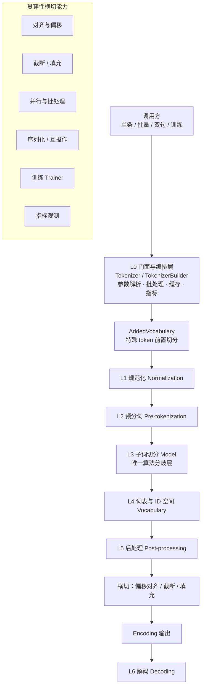
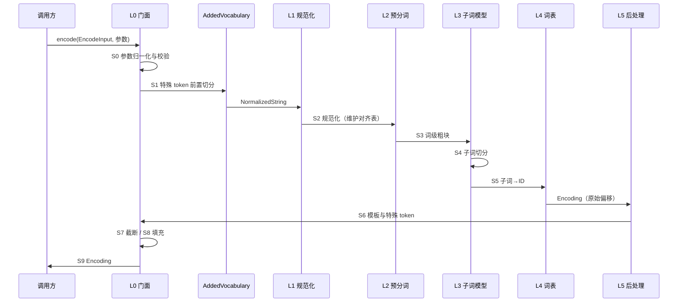

---
AIGC:
    Label: "1"
    ContentProducer: 001191440300708461136T1XGW3
    ProduceID: 04526fdd866a8c5c9aceee6b83ed2c05_e3188a9eca0011f18533525400638852
    ReservedCode1: aFhOQ8sdOt2V0bz/EG+OPUKDzk5i3U+XJChNWNL8A1o4e+MwhVg62z2jQqt1lyHmR8muR5ecFJ8lG50M7GVLebsQRoLlIBhrZqTTkFxZggJwa1hdJc4+OUb0Uk59ejE5qgcRGzenp8tMzGlXrCOMLb4K9w4gZqT0JD93WT6BBVJOHdkXczye4Fkm4L8=
    ContentPropagator: 001191440300708461136T1XGW3
    PropagateID: 04526fdd866a8c5c9aceee6b83ed2c05_e3188a9eca0011f18533525400638852
    ReservedCode2: aFhOQ8sdOt2V0bz/EG+OPUKDzk5i3U+XJChNWNL8A1o4e+MwhVg62z2jQqt1lyHmR8muR5ecFJ8lG50M7GVLebsQRoLlIBhrZqTTkFxZggJwa1hdJc4+OUb0Uk59ejE5qgcRGzenp8tMzGlXrCOMLb4K9w4gZqT0JD93WT6BBVJOHdkXczye4Fkm4L8=
---

# Tokenizer 流水线架构设计方案


> 📅 生成日期：2026-10-17


---


# 第 1 章 设计目标、约束与总体分层架构

## 1.1 现状盘点

对 `E:\tokenizer_rust` 目录的勘察结果为：目录下仅有 3 份 Markdown 资料，无源码、无构建脚本、无依赖清单。

| 文件 | 大小（字节） | 在本方案中的定位 |
|---|---|---|
| `Tokenizer完全指南.md` | 26,716 | **主依据**。其 §2 给出六层流水线骨架，§3 给出第 3 层算法细节，§5 给出工程实践与常见坑 |
| `Tokenizer最新研究_2026.md` | 52,413 | 前沿增量。用于第 4 章扩展点与第 5 章演进路线的输入 |
| `多模态统一Token空间_文献调研报告.md` | 26,839 | 多模态方向专题。仅在模态前端扩展点中引用 |

**结论**：这是一个全新（greenfield）工程——没有历史包袱，也没有既有兼容责任，接口可以按理想形态设计。相应地，方案必须一次性把"层边界"和"契约"定清楚，避免后续在无约束的状态下长出分支代码。

## 1.2 设计目标

| 编号 | 目标 | 量化口径（**均为设计目标值，尚未实测**） |
|---|---|---|
| G1 | **单一流水线抽象** | 六层结构对调用方不可见；五种主流算法（BPE / WordPiece / Unigram / SentencePiece 风格 / 字节级 BPE）的差异 100% 由配置表达，内核中不出现按算法名分支的代码 |
| G2 | **对齐可验证** | 在英文、中文、中英混排、emoji 四类语料上，与参考实现的逐 token ID 序列一致率目标 100%（不一致即视为缺陷，不做"接近即可"的容忍） |
| G3 | **无 OOV 保障** | 字节级与 `byte_fallback` 配置下，任意合法 UTF-8 输入的编码往返（encode→decode）可还原原文；不可还原的情形必须显式报错而非静默替换 |
| G4 | **offset 可溯源** | 即使开启 NFKC / 去音标 / 小写折叠等有损规范化，返回的 `(start, end)` 仍指向**原始输入字符串**的字符区间，可用于 NER 高亮与幻觉溯源 |
| G5 | **生态兼容** | 可无损读写 HF `tokenizers` 的 `tokenizer.json`；可与 tiktoken 的 `mergeable_ranks` + `pat_str` + `special_tokens` 三元组双向转换 |
| G6 | **可扩展、可并发** | 新增一种子词算法或规范化规则的改动面为"1 个实现文件 + 1 行配置注册"，不触碰 `tok-core` 与 `tok-pipeline`；`Tokenizer` 满足 `Send + Sync`，批量接口可跨核并行 |
| G7 | **面向服务端负载** | 批量编码接口支持按长度分桶；编码器抽象预留在线/增量实现位（见 §4.4），使后续降低首 token 延迟无需破坏性重构 |

## 1.3 非目标（本期明确不做）

以下内容不属于 V1.0 范围，方案只在接口上留位，不投入实现：

- 模型侧工作：嵌入层构建、`resize_token_embeddings`、embedding 重训、推理服务。
- GPU / SIMD 手写内核（V1.0 只做算法层优化与多线程，向量化留到 V1.x 按基准数据决定）。
- 在线分词、会话增量分词、模块化子词表抽取、无 tokenizer（字节 patch）路线、多模态前端——见 §4.4、§4.5 与第 5 章路线图。
- 训练新词表所需的大规模语料治理（本方案只提供训练器与接口，不提供语料管线）。

## 1.4 约束与假设

**约束**

1. 语言与工具链：Rust 稳定版工具链，工作区（workspace）组织；目标平台覆盖 Windows / Linux / macOS（Windows 为一等公民）。
2. 依赖候选（仅在确有必要时引入）：`serde` + `serde_json`（配置与序列化）、`regex`（预分词与替换规则）、`unicode-normalization`（NFC/NFD/NFKC/NFKD）、`rayon`（批量并行）、`thiserror`（错误类型）、`clap`（CLI）、`ahash`（词表哈希）。**不引入**重量级 NLP 框架，词表与算法全部自持，避免被上游版本行为变更牵动。
3. 内存假设：词表规模在 3 万 ~ 30 万条目量级，可整体常驻内存；不假设有外部存储。
4. 兼容性约束：读写 `tokenizer.json` 时以"参考实现可原样加载"为验收前提（见第 5 章）。

**假设**

- 调用方负责保证 tokenizer 与模型权重成对使用；本方案通过"词表指纹"提供校验手段（§2.4），但不替调用方阻断。
- 输入文本为合法 UTF-8。非法字节序列属于调用方错误，本方案显式报错（`TokenizerError::InvalidUtf8`），不做替补字符静默替换。
- 词表规模、是否使用 `byte_fallback`、padding 侧等属于**部署期参数**，由配置注入，不在代码中固化默认值以外的假设。

## 1.5 总体分层架构

架构以指南 §2 的六层骨架为基准，**原样保留层的划分与顺序**，并补齐横切能力与工程层。整体呈"一个门面 + 六层内核 + 一组横切能力"的形态。



各层职责一句话概览：

| 层 | 名称 | 职责 | 相对算法的不变部分 |
|---|---|---|---|
| L0 | 门面与编排 | 解析调用参数、装配流水线、批处理调度、结果组装 | 全部 |
| — | AddedVocabulary | 特殊 token 优先匹配与切分（**必须早于规范化**） | 全部 |
| L1 | 规范化 | 收敛文本表面形式 | 全部（选项不同） |
| L2 | 预分词 | 切出词级粗块并建立初步对齐 | 全部（规则不同） |
| L3 | 子词切分 | 词级粗块 → 子词序列 | **唯一算法分歧层** |
| L4 | 词表与 ID 空间 | 子词 ↔ 整数 ID 双向映射 | 全部（**形态随 L3 变化**） |
| L5 | 后处理 | 包装成模型输入形态（模板、特殊 token、type_ids） | 全部 |
| L6 | 解码 | 子词序列 → 文本 | 全部（还原规则不同） |

> 关键认识（来自指南 §2.11）：不存在"只换子词算法"的孤立替换。L3 的切换会连带改变 L2 的预分词方式、L4 的词表形式与 L6 的解码规则。因此本方案把"一份配置档案"作为原子单位——切换算法 = 切换一整份配置，而不是逐个字段改参数。

## 1.6 工作区划分与依赖方向

工作区按"契约 / 实现 / 编排 / 适配"四类拆分 crate，依赖方向**严格单向**：

```
调用方
  └── tok-cli                    （命令行：训练 / 编码 / 对比 / 基准）
        └── tok-pipeline         （门面、编排、批处理、截断填充、缓存、指标）
              ├── tok-normalizers ┐
              ├── tok-pretok      │
              ├── tok-models      ├─ 均只依赖 tok-core
              ├── tok-post        │
              ├── tok-decoders    │
              ├── tok-trainers    ┘
              └── tok-compat     （HF tokenizer.json / tiktoken 互操作适配）
                    └── tok-core （公共数据结构、trait 契约、错误类型、配置模型、Vocabulary）
```

| Crate | 内容 | 依赖 |
|---|---|---|
| `tok-core` | `Normalizer` / `PreTokenizer` / `Model` / `PostProcessor` / `Decoder` / `Trainer` 六个 trait；`NormalizedString`、`PreToken`、`Token`、`Encoding`、`Vocabulary`、`AddedToken`；`TokenizerError`；配置结构 | 仅基础库（serde / thiserror / regex 等），**不依赖任何同工作区 crate** |
| 六个实现 crate | 各层的内置实现（见第 2 章） | 只依赖 `tok-core` |
| `tok-pipeline` | `Tokenizer` 门面、`TokenizerBuilder`、批处理、截断填充、并行调度、编码器抽象 | `tok-core` + 全部实现 crate |
| `tok-compat` | 外部格式读写与三检查点校验 | `tok-core`、`tok-pipeline` |
| `tok-cli` | 命令行入口 | 全部 |

**依赖红线（三条）**

1. 六个实现 crate **禁止互相依赖**（例如 `tok-models` 不得依赖 `tok-pretok`）。字节级 BPE 由配置组合而成，而非代码耦合（见 §2.3）。
2. 实现 crate **禁止依赖** `tok-pipeline`；`tok-pipeline` 只做装配，不反向被依赖。
3. `tok-core` **禁止依赖**任何具体算法实现，也禁止依赖 `tok-pipeline`。

违反红线的直接后果是"引入一个新算法需要改门面"，这正是本方案要避免的失败模式。

## 1.7 关键架构决策

| 编号 | 决策 | 理由与代价 |
|---|---|---|
| **AD-1** | **契约用 trait，内置实现用枚举静态分发，自定义走 `Custom(Box<dyn …>)` 逃生舱** | 六个组件的分发发生在每个词块的热路径上。纯 `dyn` 会带来间接调用与缓存不友好；纯泛型单态化会让配置装配产生组合爆炸。折中方案：内置实现收敛为一个 `enum`（静态分发、便于穷举与序列化），同时保留 `Custom` 变体承接用户自定义组件 |
| **AD-2** | **层间按值传递（消费式），不共享可变状态** | `NormalizedString` → `PreTokenizer` 的输出是**就地可变**的句柄，一旦进入 L3 即转为只读 `&str`。禁止跨层传递 `&mut` 累积状态，避免为并发加锁 |
| **AD-3** | **配置驱动装配，未知字段拒绝加载** | 一份配置档案描述整条流水线（六个层各填一个实现）。配置反序列化启用 `deny_unknown_fields`，让"配置里写了但实现不认识"直接失败，而不是静默忽略——这是跨版本升级时最容易被忽略的错配来源 |
| **AD-4** | **`Tokenizer` 构建后不可变，天然 `Send + Sync`** | 训练与推理分离：训练产出配置与词表文件，推理期只读加载。可变状态仅存在于批量编码的局部工作区，不进共享结构；缓存挂在门面内部且只读，不需要 `Mutex` 保护 |
| **AD-5** | **统一错误类型，禁止 panic 与静默降级** | 所有层返回 `Result<_, TokenizerError>`，错误携带层标识与上下文（如 `Layer::Model { token: String }`）。禁止用 `unwrap()` 处理输入；禁止在无法编码时静默丢弃字符 |
| **AD-6** | **词表携带指纹，供模型侧校验成对使用** | `Vocabulary` 暴露 `fingerprint()`（词表内容 + 特殊 token 及其 ID 的稳定哈希）。换 tokenizer 却沿用旧权重＝ID 语义错乱（指南 §5.3 首条坑），指纹把这一人为约束变成一次可编程的比对 |
| **AD-7** | **UTF-8 字节序列作为一切算法的最终兜底底座** | 无论 L3 采用哪种算法，L4 都保留 256 个字节兜底单元的预留区间；`byte_fallback` 与字节级方案因此共享同一套 ID 空间规则，而不是两套特例 |

---


---


# 第 2 章 各层模块职责与接口契约

本章定义每一层的职责边界与 Rust 接口。所有 trait 定义在 `tok-core`，实现分散在各自 crate。trait 签名以"能表达五种主流算法的行为差异"为最小充分集，不追求万能。

## 2.1 契约总则（六条）

1. **只依赖 `tok-core` 类型**：层间传递的参数与返回值必须是 `tok-core` 中定义的结构，禁止各实现私有的中间类型穿透层边界。
2. **输入按值、输出按值**：除 L3 的只读查询（`token_to_id` 等）外，一律按值传递，避免生命周期耦合与跨层借用。
3. **错误显式**：所有可能失败的操作返回 `Result`；不可失败的操作（如 `id_to_token`）返回 `Option`。
4. **不自行并行**：实现层**禁止**内部起线程池（`rayon` 只允许出现在 `tok-pipeline`），否则批处理与外层并集会互相争抢。
5. **不持有跨调用可变状态**：实现必须可安全共享；有状态需求（如统计）通过显式参数或 `&mut` 局部变量传递。
6. **一实现一配置标签**：每个实现对应一个 serde 标签值，配置即注册表。

## 2.2 L1 规范化层（Normalizer）

**职责**：把表面形式各异但语义相同的文本收敛到统一形式；**同时维护字符对齐表**（这是本层最容易被忽视、却决定 offset 正确性的职责）。

```rust
pub trait Normalizer: Send + Sync {
    /// 消费式规范化：原串保留在对齐表中，normalized 为结果
    fn normalize(&self, input: NormalizedString) -> NormalizedString;
}
```

内置实现与配置标签：

| 实现 | 配置标签 | 行为 | 可逆性 |
|---|---|---|---|
| `Nfc` / `Nfd` | `NFC` / `NFD` | 组合字符合成 / 分解 | 可逆 |
| `Nfkc` / `Nfkd` | `NFKC` / `NFKD` | 兼容分解再合成（全角、连字、上标、圈号） | **不可逆** |
| `Lowercase` | `Lowercase` | 统一小写 | 不可逆（信息丢失） |
| `Casefold` | `Casefold` | 更激进的大小写折叠（如 `ß`→`ss`） | 不可逆且**改变长度** |
| `StripAccents` | `StripAccents` | 去音标 | 不可逆 |
| `Replace` | `Replace` | 正则替换（可配 `pattern` + `content`） | 视规则而定 |
| `Prepend` / `Strip` | `Prepend` / `Strip` | 加/去前缀、去首尾空白 | 不可逆 |
| `Sequence` | `Sequence` | 串联多个规范化器 | 取决于成员 |
| `Identity` | `Identity` | 不做任何处理 | 完全可逆 |
| `Custom` | `Custom` | 用户自定义 | — |

**契约约束**：凡是改变字符数量的实现（NFKC、Casefold、StripAccents、Replace），**必须**更新 `NormalizedString` 内的对齐表；未更新即视为实现缺陷，由调试断言（§3.7）在测试构建中捕获。

> 设计取舍：默认配置为 `Identity`。指南 §2.1 与 §6 的结论一致——规范化越多压缩率越高但不可逆，现代主流做法是不做有损规范化、改用字节兜底。本方案把"是否有损"作为配置项显式暴露，而不是替用户默认选择。

## 2.3 L2 预分词层（PreTokenizer）

**职责**：在子词切分之前把文本切成词级粗块，并给出每个粗块在原串中的偏移。

```rust
pub trait PreTokenizer: Send + Sync {
    /// 就地切分句柄；实现通过 split 写入各段及其相对偏移
    fn pre_tokenize(&self, pretok: &mut PreTokenizedString);

    /// 便捷入口（默认实现），供单测与 CLI 直接使用
    fn pre_tokenize_str(&self, s: &str) -> Vec<(String, (usize, usize))> {
        let mut p = PreTokenizedString::from(s);
        self.pre_tokenize(&mut p);
        p.into_iter().map(|pt| (pt.value, pt.offsets)).collect()
    }
}
```

内置实现：

| 实现 | 配置标签 | 规则 | 典型配置档案 |
|---|---|---|---|
| `Whitespace` | `Whitespace` | 按空白切 | 简单场景 |
| `WhitespaceSplit` | `WhitespaceSplit` | 空白切且保留分隔符 | — |
| `BertPreTokenizer` | `BertPreTokenizer` | 空白切 + 标点隔离 | WordPiece / BERT 型 |
| `ByteLevel` | `ByteLevel` | 字节可打印化映射 + GPT-2 正则捕获 | BPE / RoBERTa、tiktoken 型 |
| `Metaspace` | `Metaspace` | 空格替换为 `▁` 并切分 | SentencePiece / T5 型 |
| `Digits` | `Digits` | 每个数字单独成块 | Gemma/Gemini 型（利于算术） |
| `Split` | `Split` | 自定义正则 + 分隔符处置策略 | 领域定制 |
| `Punctuation` | `Punctuation` | 标点独立成块 | — |
| `Sequence` | `Sequence` | 串联多个预分词器 | 组合 |
| `ByteLevelAligned` | `ByteLevelAligned` | 字节映射但保留原字符偏移 | 需 offset 的字节级场景 |
| `Custom` | `Custom` | 用户自定义 | — |

`Split` 的分隔符处置策略必须显式指定，四种取值：`Removed` / `Isolated` / `MergedWithPrevious` / `MergedWithNext`。`ByteLevel` 的 `add_prefix_space` 与 `trim_offsets` 行为（RoBERTa 与 GPT-2 在此处有差异）同样作为显式字段，不设隐式默认。

> 关键实现细节：GPT-2 正则模式（`'s|'t|'re|'ve|'m|'ll|'d| ?\p{L}+| ?\p{N}+| ?[^\s\p{L}\p{N}]+|\s+(?!\S)|\s+`）必须在**配置中可覆写**（对应 tiktoken 的 `pat_str`），因为 tiktoken 与 HF 输出对齐的第一检查点就是"同一份 `pat_str`"。

## 2.4 L3 子词切分层（Model）——唯一算法分歧层

**职责**：把词级粗块切分为子词序列，并完成子词与 ID 的双向映射。

```rust
pub trait Model: Send + Sync {
    /// 单块切分：输入已是预分词后的词块，输出子词 Token 序列
    fn tokenize(&self, sequence: &str) -> Result<Vec<Token>, TokenizerError>;

    /// ID 双向映射
    fn token_to_id(&self, token: &str) -> Option<u32>;
    fn id_to_token(&self, id: u32) -> Option<String>;
    fn get_vocab(&self) -> &Vocabulary;

    /// 持久化（供训练后导出）
    fn save(&self, folder: &Path, prefix: Option<&str>) -> Result<Vec<PathBuf>, TokenizerError>;

    /// 训练入口：返回与本模型配套的 Trainer（无训练能力返回 None）
    fn get_trainer(&self) -> Option<Box<dyn Trainer>>;
}
```

内置实现与算法差异落点（差异**全部**体现在本层的实现体内，不泄漏到其他层）：

| 实现 | 训练方向 | 合并/选择准则 | 编码算法 | 复杂度 |
|---|---|---|---|---|
| `Bpe` | 自底向上合并 | 频次最高 | 按 rank 贪心合并 | O(n log n) 量级 |
| `WordPiece` | 自底向上合并 | 似然增益 `freq(ab)/(freq(a)·freq(b))` | 最长匹配优先 | 同上 |
| `WordLevel` | 无（人工词表） | — | 整块查表 + `[UNK]` | O(1) |
| `Unigram` | 自顶向下剪枝 | EM 概率 + loss 增量剪枝 | **Viterbi 全局最优** | 训练昂贵，编码略慢 |

**必须澄清的一点**：字节级 BPE **不是第五种算法**（指南 §3.5 的归位结论）。它是同一条流水线上的一份配置组合：

```
Byte-level BPE 配置档案 =
  L1: Identity
+ L2: ByteLevel（字节可打印化 + GPT-2 正则）
+ L3: Bpe（词表初始化为 256 个字节而非字符）
+ L4: 字节兜底区间 + special_tokens
+ L5: TemplateProcessing
+ L6: ByteLevel 解码器
```

因此 `tok-models::Bpe` 必须通过**参数**（`initial_alphabet` / `byte_level` 标志）支持"以字节为初始字母表"，而**不允许**另写一个 `ByteLevelBpe` 实现——否则 L6 与 L2 会被迫耦合进 `tok-models`，直接违反 §1.6 的依赖红线。

**`Unigram` 的能力开关**：`SubwordRegularization`（训练/编码期采样）、`N-best` 输出候选作为可选方法暴露：

```rust
pub trait Model { /* ... */ }

/// Unigram 专属能力，通过 trait 向上转型访问，不污染 Model 基础契约
pub trait Sampleable: Model {
    fn tokenize_with_sampling(&self, seq: &str, rng: &mut dyn RngCore) -> Result<Vec<Token>, TokenizerError>;
    fn nbest_tokenize(&self, seq: &str, n: usize) -> Result<Vec<Vec<Token>>, TokenizerError>;
}
```

## 2.5 L4 词表与 ID 空间层（Vocabulary）

**职责**：子词 ↔ ID 的双向映射、特殊 token 登记、ID 区间规划、指纹计算。

```rust
pub struct Vocabulary {
    token_to_id: HashMap<String, u32>,   // ahash
    id_to_token: Vec<Option<String>>,    // 稠密，允许空洞
    added: AddedVocabulary,
    layout: IdLayout,
}

pub struct IdLayout {
    pub base: Range<u32>,          // 基础词表（合并/概率表产出）
    pub byte_fallback: Option<Range<u32>>,  // 256 个 <0x00>..<0xFF>
    pub added: Range<u32>,         // 特殊与后加 token
    pub reserved: Range<u32>,      // 预留区间，供未来扩展（如模态 token）
}
```

**结构性防呆设计（对应指南 §5.3 的两个坑）**

| 坑 | 结构性对策 |
|---|---|
| 特殊 token ID 硬编码 | 代码中**禁止**出现特殊 token 的字符串字面量或 ID 字面量；一切特殊 token 从配置读入并登记到 `AddedVocabulary`，对外只暴露 `Tokenizer::token_id_of(&self, name: &TokenName) -> Option<u32>`，`TokenName` 为配置中声明的具名条目 |
| tokenizer 与权重不匹配 | `Vocabulary::fingerprint() -> u64`：对（排序后的 token→id 全表 + 特殊 token 名称与 ID + ID 区间布局）做稳定哈希。调用方可在加载模型权重时与训练期记录的指纹比对，不一致直接拒绝启动 |
| 版本间 BOS/EOS 差异（如 LLaMA 各版本） | 特殊 token 不设内置默认值；加载第三方配置时若缺失关键角色 token，返回 `TokenizerError::MissingSpecialToken`，**由调用方显式提供**，禁止回退到猜测值 |

**ID 区间固定顺序**：基础词表 → 字节兜底 → 特殊/后加 token → 预留。该顺序一旦写入配置即冻结，保证同一份配置在任何实现间产出相同的 ID。

## 2.6 L5 后处理层（PostProcessor）

**职责**：把子词序列包装成模型输入形态——插入特殊 token、生成 `type_ids`、构造 `special_tokens_mask`。

```rust
pub trait PostProcessor: Send + Sync {
    /// 本处理器会额外产生多少个 token（用于截断预算计算）
    fn added_tokens(&self, is_pair: bool) -> usize;

    fn process(
        &self,
        encoding: Encoding,
        pair: Option<Encoding>,
        add_special_tokens: bool,
    ) -> Result<Encoding, TokenizerError>;
}
```

| 实现 | 配置标签 | 效果 |
|---|---|---|
| `TemplateProcessing` | `TemplateProcessing` | 通用模板（`$A` / `$B` / `:0` 形式），设置 `type_id` 与特殊 token；**现代首选** |
| `BertProcessing` | `BertProcessing` | 自动加 `[CLS]` / `[SEP]` |
| `RobertaProcessing` | `RobertaProcessing` | 加 `<s>` / `</s>` |
| `Sequence` | `Sequence` | 串联多个后处理器 |
| `ByteLevel`（仅裁剪） | `ByteLevel` | 字节级场景下裁掉多余前缀空格对应的 token |
| `Custom` | `Custom` | 用户自定义 |

**契约约束**：`added_tokens()` 必须在截断之前被调用，因为截断预算是"`max_length` 减去模板额外开销"。把这一计算放在后处理层而不是门面层，是本层存在的核心理由。

## 2.7 L6 解码层（Decoder）

**职责**：子词序列 → 文本，不同算法各有还原规则。

```rust
pub trait Decoder: Send + Sync {
    /// 链式解码：一次处理一批 token 片段，便于 Sequence 组合
    fn decode_chain(&self, tokens: Vec<String>) -> Result<Vec<String>, TokenizerError>;
}
```

| 实现 | 配置标签 | 还原规则 |
|---|---|---|
| `Fuse` | `Fuse` | 直接拼接（默认） |
| `ByteLevel` | `ByteLevel` | 反向可打印化映射，按 UTF-8 拼回 |
| `WordPiece` | `WordPiece` | 去词内前缀 `##` 后拼接 |
| `Metaspace` | `Metaspace` | `▁` 还原为空格 |
| `BPEDecoder` | `BPEDecoder` | 去词尾标记 `</w>` |
| `Replace` | `Replace` | 解码阶段再做一次正则替换 |
| `Strip` | `Strip` | 去首尾空白 |
| `Sequence` | `Sequence` | 串联多个解码器 |
| `Custom` | `Custom` | 用户自定义 |

> 边界划分：`skip_special_tokens` 与 `clean_up_tokenization_spaces` **不属于本层**，它们在门面层（L0）执行——前者是"挑哪些 token 进入解码链"，后者是"对最终字符串做后处理"，都不是某一种算法特有的还原规则。把它们放进 `Decoder` 会导致每个实现重复实现同一逻辑。

## 2.8 训练侧契约（Trainer）

**职责**：从语料迭代器学习词表与模型参数，产出可序列化的 `Model` 与 `Vocabulary`。

```rust
pub trait Trainer {
    fn train(
        &self,
        model: &mut dyn Model,
        sequences: &mut dyn Iterator<Item = String>,
    ) -> Result<Vec<AddedToken>, TokenizerError>;
}

pub struct TrainerParams {
    pub vocab_size: usize,
    pub min_frequency: u64,
    pub special_tokens: Vec<AddedToken>,
    pub initial_alphabet: Vec<String>,   // 字节级方案传 256 个字节
    pub byte_fallback: bool,
    pub character_coverage: f32,         // Unigram / SentencePiece 风格
    pub split_digits: bool,
    pub max_token_length: Option<usize>,
    pub seed: u64,
    pub unk_token: Option<String>,
}
```

| 实现 | 关键机制 | 训练成本 |
|---|---|---|
| `BpeTrainer` | 相邻符号对频次统计 → 迭代合并 | 低 |
| `WordPieceTrainer` | 同结构，改用 PMI 近似评分 | 低 |
| `UnigramTrainer` | 超候选池 → EM 迭代 → loss 增量剪枝 | 高（多次迭代） |
| `WordLevelTrainer` | 仅频次截断，无子词合并 | 极低 |

**契约约束**：训练器**独占** `&mut dyn Model`，禁止在训练过程中让模型暴露半成品词表；训练语料以迭代器流式喂入，禁止要求一次性载入全部语料（这是 Unigram 之外可以承受的约束，但接口必须统一支持流式）。`min_frequency` 与 `vocab_size` 同时设定时，实际词表可能小于目标值，返回值需携带最终规模供调用方记录。

## 2.9 L0 门面与编排层（Tokenizer）

门面是唯一对外可见的类型，六层结构对调用方完全透明。

| 类别 | 方法 | 说明 |
|---|---|---|
| 构建 | `from_file(path)` / `from_json_str(s)` / `from_config(cfg)` | 加载配置并装配流水线；未知字段/缺失组件立即报错 |
| 单条编码 | `encode(input: EncodeInput, add_special_tokens: bool)` | `EncodeInput::Single/Dual`，返回 `Encoding` |
| 批量编码 | `encode_batch(inputs: Vec<EncodeInput>, add_special_tokens: bool)` | 返回 `Vec<Encoding>`，内部并行 + 分桶 |
| 解码 | `decode(ids, skip_special_tokens)` / `decode_batch(...)` | 走 L6 解码链 |
| 训练 | `train_from_iterator(iter, trainer_params)` / `train(files, params)` | 装配 Trainer 并导出 |
| 持久化 | `save(folder, prefix)` / `to_json()` | 写出配置档案 |
| 校验 | `vocab_fingerprint()` / `token_id_of(name)` / `validate() -> ValidationReport` | 指纹、具名 token 查询、自检报告 |
| 元信息 | `layer_config()` | 返回各层当前实现名，用于排障与日志（不是给调用方做分支判断） |

**编排职责清单（门面的全部工作，不得下放）**

1. 参数归一化与合法性校验（`max_length`、`padding` 侧与 `truncation` 方向的组合）。
2. 特殊 token 前置切分（`AddedVocabulary`，必须早于 L1）。
3. 逐层调用六个组件，按 `Sequence` 语义展开链式组件。
4. 截断 → 填充的顺序固定（先截断后填充，填充只为对齐批次）。
5. 组装配对结果（双句的 `type_ids` / `token_type_ids` / `attention_mask` / `special_tokens_mask` / `offsets` / `overflowing`）。
6. 并行调度（`rayon` 只在此处出现）与长度分桶。
7. 指标采集与缓存查询。

**`EncodeInput` 定义**

```rust
pub enum EncodeInput<'a> {
    Single(Cow<'a, str>),
    Dual { text: Cow<'a, str>, text_pair: Cow<'a, str> },
}
```

## 2.10 层间契约一致性核对表

| 层 | 输入 | 输出 | 失败语义 |
|---|---|---|---|
| AddedVocabulary | `&str` | `NormalizedString`（含特殊 token 段标记） | 特殊 token 无法匹配 → 不报错，按普通文本继续 |
| L1 Normalizer | `NormalizedString` | `NormalizedString` | 正则非法（配置期）、对齐表不一致（断言） |
| L2 PreTokenizer | `&mut PreTokenizedString` | 原地切分后的句柄 | 正则回溯超限 → `Pretokenization` |
| L3 Model | `&str`（单个词块） | `Vec<Token>` | 无法编码且无兜底 → `Model`（不静默替换） |
| L4 Vocabulary | `&str` / `u32` | `Option<u32>` / `Option<String>` | 无（缺失返回 `None`，由上层决定语义） |
| L5 PostProcessor | `Encoding` (+ 可选 pair) | `Encoding` | 模板引用的特殊 token 未登记 → `PostProcessing` |
| L6 Decoder | `Vec<String>` | `Vec<String>` | 字节序列非法（非 UTF-8）→ `Decoding` |
| L0 门面 | `EncodeInput` + 参数 | `Encoding` / `Vec<Encoding>` | 参数非法 → `InvalidArgument`；超长且未开启截断 → `SequenceTooLong` |

---


---


# 第 3 章 端到端数据流与关键数据结构

## 3.1 编码主链路（encode）

一次 `encode` 调用依次穿过 10 个阶段。阶段划分与指南 §2 的六层骨架严格对应，额外的四个阶段（S0、S1、S7、S8）属于门面层的编排职责。



| 阶段 | 执行层 | 输入 | 输出 | 备注 |
|---|---|---|---|---|
| S0 | L0 | `EncodeInput` + `EncodeParams` | 校验后的参数 | 校验 padding 侧 × truncation 方向组合；`max_length` 与模板开销的总量预算检查 |
| S1 | AddedVocabulary | `&str` | `NormalizedString`（含特殊 token 段） | **必须早于 S2**：特殊 token 按字面匹配，一旦先做规范化就可能匹配不上 |
| S2 | L1 | `NormalizedString` | `NormalizedString`（归一 + 对齐表） | 有损规范化在此发生，长度可变 |
| S3 | L2 | `NormalizedString`（可变句柄） | `Vec<PreToken>` | 每块携带相对偏移；字节级方案在此同时完成字节映射 |
| S4 | L3 | 单个 `PreToken.value`（`&str`） | `Vec<Token>` | **唯一算法分歧点**；逐块独立，可并行 |
| S5 | L4 | 子词字符串 | `u32` ID | 查表；未命中且无兜底 → 显式错误 |
| S6 | L5 | `Encoding`（ids + offsets） | `Encoding`（含特殊 token、`type_ids`） | `added_tokens()` 先于 S7 参与预算计算 |
| S7 | L0 | `Encoding` | `Encoding` + `overflowing` | 按 `TruncationStrategy` 切分；被裁部分若配置保留则进 `overflowing` |
| S8 | L0 | `Encoding` | `Encoding` | 仅补齐到批次长度；`attention_mask` 在此生成 |
| S9 | L0 | 全部中间结果 | 最终 `Encoding` | 组装 `offsets` / `special_tokens_mask` / `sequence_ranges` |

**语义固定点（不可配置）**

1. **顺序固定**：S1 → S2 → S3 → S4 → S5 → S6 → S7 → S8。其中 S7 必在 S8 之前（先截断再填充，否则截断会把 padding 当成内容）。
2. **S4 并行边界**：子词切分以"预分词块"为并行单位，块内串行。这是 L3 唯一被允许的并行粒度（线程池由 L0 提供，见 §2.1 契约第 4 条）。
3. **S5 无状态**：ID 映射必须是纯查表，不得在编码期修改词表。词表只能由训练或加载期构造。

## 3.2 双句与批量链路

**双句**：S1–S5 对 `text` 与 `text_pair` 各自独立执行一遍，得到两个 `Encoding`；在 S6 由 `PostProcessor` 合并——插入分隔 token、为第二句的区间赋 `type_id = 1`，并在 `sequence_ranges` 中登记两段各自的 `(start, end)` 区间。

```
Single: [CLS] A_tokens [SEP]
Dual  : [CLS] A_tokens [SEP] B_tokens [SEP]
                type_id=0        type_id=1
```

**批量**：`encode_batch` 的三段式流程：

1. **分桶**：按字符长度（近似 token 数）排序分桶，桶内长度相近 ⇒ padding 浪费最小；
2. **并行**：桶内并行执行 S1–S6（`rayon` 线程池，由门面持有并复用）；
3. **归位**：S7 截断（`max_length` 全局或按桶的 `longest`）、S8 填充到桶内最大长度，最后按原始输入顺序还原结果顺序。

```rust
pub fn encode_batch(&self, inputs: Vec<EncodeInput>, params: &EncodeParams)
    -> Result<Vec<Encoding>, TokenizerError>;
```

**约束**：批量接口的结果必须与逐条调用 `encode` 的结果**逐字段相等**（除 padding 长度差异外）。这条约束是测试用例的直接来源（§5.3）：任何并行化引入的非确定性都是缺陷。

## 3.3 解码链路（decode）

```
Vec<u32>
 → L4  id_to_token
 → L0  过滤 skip_special_tokens（保留 special_tokens_mask 一致的 token）
 → L6  Decoder::decode_chain（可能多级串联）
 → L0  拼接
 → L0  clean_up_tokenization_spaces（可选，仅处理英文标点前的空格等表面问题）
 → String
```

**约束**：解码**不得**经过规范化或预分词的逆过程推断原文；`decode` 的正确性由 L6 的解码器负责，缺什么补什么，不用正则"猜"（这是跨实现解码不一致的常见根因）。

## 3.4 训练链路

```
语料迭代器（流式）
 → L1 规范化（可选；训练期规范化必须与推理期完全一致）
 → L2 预分词
 → 频次统计（并行局部计数 → 归并，避免全局锁）
 → Trainer（WordLevel: 截断 / BPE & WordPiece: 迭代合并 / Unigram: EM + 剪枝）
 → Model + Vocabulary 固化
 → 序列化：tokenizer.json / vocab.txt + merges.txt / tiktoken 三元组
 → 指纹记录（写入配置，供推理期校验）
```

**关键约束**：**训练期与推理期的 L1/L2 必须是同一份配置**。若训练时做了 `Lowercase` 而推理时没有（或反之），词表会出现大量未命中——这一约束在架构上通过"配置档案同时驱动训练与推理"来保证，而不是靠文档提醒。

## 3.5 关键数据结构

贯穿全链路的核心结构只有两个：`NormalizedString`（承载对齐）与 `Encoding`（承载结果）。

```rust
/// 规范化过程中的字符串，携带"归一化后位置 → 原文位置"的对齐表
pub struct NormalizedString {
    original: String,
    normalized: String,
    alignments: Vec<(usize, usize, usize)>, // (norm_start, norm_end, orig_start)
    splits: Option<Splits>,                 // 预分词产生的分段标记
}

#[derive(Clone, Copy, PartialEq, Eq)]
pub struct Offset { pub start: usize, pub end: usize }
```

```rust
/// 预分词块（L2 输出，L3 输入）
#[derive(Clone)]
pub struct PreToken {
    pub id: usize,
    pub value: String,          // 已按 L2 规则处理后的字符串（如已字节映射）
    pub offsets: (usize, usize),// 相对原始输入字符区间
}

/// 子词 token（L3 输出）
#[derive(Clone)]
pub struct Token {
    pub id: u32,
    pub value: String,
    pub offsets: (usize, usize),
}
```

```rust
/// 编码结果：全部向量等长，长度 = 最终序列长度
#[derive(Clone, Default)]
pub struct Encoding {
    pub ids: Vec<u32>,
    pub type_ids: Vec<u32>,
    pub tokens: Vec<String>,
    pub offsets: Vec<(usize, usize)>,
    pub attention_mask: Vec<u32>,
    pub special_tokens_mask: Vec<u32>,
    pub sequence_ranges: HashMap<usize, (usize, usize)>,
    pub overflowing: Vec<Encoding>,
}
```

```rust
/// 特殊与后加 token 的登记与匹配规则
#[derive(Clone)]
pub struct AddedToken {
    pub content: String,
    pub single_word: bool,
    pub lstrip: bool,
    pub rstrip: bool,
    pub normalized: bool,   // false 表示不参与规范化，按字面匹配
    pub special: bool,      // 影响 special_tokens_mask 与 skip_special_tokens
}

pub struct AddedVocabulary {
    token_to_id: HashMap<String, u32>,
    id_to_token: Vec<Option<String>>,
    trie: AhoCorasick,      // 多模式匹配，支撑 S1 的前置切分
}
```

```rust
/// 截断与填充参数
pub struct TruncationParams {
    pub max_length: usize,
    pub strategy: TruncationStrategy,       // LongestFirst / OnlyFirst / OnlySecond
    pub stride: usize,
    pub direction: TruncationDirection,     // Left / Right
}

pub struct PaddingParams {
    pub strategy: PaddingStrategy,          // Fixed(len) / BatchLongest
    pub direction: PaddingDirection,        // Left / Right
    pub pad_id: u32, pub pad_type_id: u32, pub pad_token: String,
}
```

**配置档案结构（L0 装配的输入）**

```rust
#[derive(Serialize, Deserialize)]
#[serde(deny_unknown_fields)]
pub struct TokenizerConfig {
    pub version: ConfigVersion,             // 语义化版本，见 §4.2
    #[serde(default)] pub normalizer: Option<NormalizerConfig>,
    #[serde(default)] pub pre_tokenizer: Option<PreTokenizerConfig>,
    pub model: ModelConfig,
    #[serde(default)] pub post_processor: Option<PostProcessorConfig>,
    #[serde(default)] pub decoder: Option<DecoderConfig>,
    #[serde(default)] pub added_tokens: Vec<AddedToken>,
    #[serde(default)] pub truncation: Option<TruncationParams>,
    #[serde(default)] pub padding: Option<PaddingParams>,
    pub vocab_fingerprint: Option<u64>,
}

/// 组件配置用带标签枚举表达"配置即注册表"
#[derive(Serialize, Deserialize)]
#[serde(tag = "type", deny_unknown_fields)]
pub enum NormalizerConfig {
    #[serde(rename = "NFC")] Nfc,
    #[serde(rename = "NFKC")] Nfkc,
    #[serde(rename = "Lowercase")] Lowercase,
    #[serde(rename = "Sequence")] Sequence { normalizers: Vec<NormalizerConfig> },
    #[serde(rename = "Custom")] Custom { name: String, params: serde_json::Value },
}
```

## 3.6 偏移对齐机制（三段式）

这是本方案中最容易产生隐性错误的部分，故单列一节说明。

| 段 | 阶段 | 机制 |
|---|---|---|
| 段一 | S2 规范化 | 每次改写操作同步更新 `alignments`；对于长度变化的操作（NFKC 合成的字符数可能变少），记录"新串区间 → 原串起点"的映射条目 |
| 段二 | S3 预分词 | 相对 `NormalizedString` 的位置；若 L2 做了字节映射（ByteLevel），映射表与位置表必须**同时**生成，禁止只生成字节串 |
| 段三 | S9 组装 | 把段二的位置经段一映射回原串，得到最终 `offsets` |

**回对齐策略**：当段一因正则替换、Casefold 等操作无法提供精确逐字符映射时，使用**序列对齐**（Needleman–Wunsch，以字符相等为匹配、以位置为代价）在"新串"与"原串"之间重建映射。触发条件与降级规则：

1. 精确映射可用 → 直接用，不进入对齐算法（性能优先）；
2. 该段出现"一对多/多对一"改写 → 进入 NW 对齐；
3. NW 对齐超过阈值（默认段长 4096 字符）→ 退化为"整段区间"近似，并在 `Encoding` 上置 `offsets_degraded = true`，**显式告知调用方**而非静默返回错位区间。

## 3.7 不变量与断言清单

以下不变量在 `debug_assertions` 构建中强制检查，在 release 构建中通过 `Tokenizer::validate()` 按需检查：

| 编号 | 不变量 | 违反后果 |
|---|---|---|
| INV-1 | `ids.len() == tokens.len() == offsets.len() == attention_mask.len() == type_ids.len() == special_tokens_mask.len()` | 模型输入错位，`Encoding` 组装处断言 |
| INV-2 | `alignments` 单调不减：`norm_start` 递增 | offset 错位 |
| INV-3 | 每个 `Token.id` 都能通过 `id_to_token` 还原为同一字符串 | 词表双射被破坏（重复 token 或 ID 空洞） |
| INV-4 | `offsets[i].1 >= offsets[i].0`，且 `<= original.len()`（按字符计） | 越界高亮 |
| INV-5 | 若 `byte_fallback` 或字节级配置启用，则任意合法 UTF-8 输入的 `decode(encode(x)) == x` | 往返不可逆 |
| INV-6 | `encode_batch` 与逐条 `encode` 结果逐字段相等 | 并行化引入不确定性 |
| INV-7 | 训练与推理使用同一 `TokenizerConfig` 的哈希 | 词表大面积未命中 |

---


---


# 第 4 章 扩展点设计

扩展点的设计目标只有一个：**新增能力时的改动面可预测**。本章逐项给出"改哪些文件、要不要动内核、如何回归"。

## 4.1 组件插件化（一级扩展点）

六个组件 trait（`Normalizer` / `PreTokenizer` / `Model` / `PostProcessor` / `Decoder` / `Trainer`）构成一级扩展点。接入一种新算法的标准动作：

| 步骤 | 动作 | 位置 |
|---|---|---|
| 1 | 实现 trait | 对应实现 crate 新增 1 个文件 |
| 2 | 在配置枚举中加一个变体 | 该层配置枚举（`tok-core`，**唯一**需要触碰 core 的场景） |
| 3 | 在装配函数中加一个 `match` 分支 | 该实现 crate 的 `build()` |
| 4 | 补 golden 用例与往返测试 | 测试目录 |

**改动面结论**：新增算法 = 1 个实现文件 + 1 个枚举变体 + 1 个装配分支，**不触碰** `tok-pipeline`、不触碰门面 API、不触碰其他层。若某次扩展需要改门面，说明该能力被错误地设计成了跨层特性，应重新拆分。

`Custom` 变体是二级逃生舱：用户可在不改 `tok-core` 的前提下，通过 `TokenizerBuilder::with_model(Box<dyn Model>)` 注入自有实现，配置中记为 `{"type": "Custom", "name": "...", "params": {...}}`，加载时由调用方提供注册回调。两条路径共存的意义是：**内置算法走静态分发保证性能，实验性算法走动态分发保证不改上游**。

**扩展点的边界规则**

| 允许作为扩展点 | 不允许 |
|---|---|
| 单个层内的算法/规则替换 | 修改层的数量或顺序 |
| 组件的组合（`Sequence`） | 让某层直接调用另一层的实现类型 |
| 通过 `Model` 的构造参数表达变体（如字节字母表） | 为某个配置组合另写一套平行实现（如单开 `ByteLevelBpe`） |

## 4.2 配置版本化与向后兼容（二级扩展点）

配置是唯一的跨版本接口，兼容策略按"只增不改"原则设计：

| 规则 | 说明 |
|---|---|
| `version` 字段 | 语义化三段版本；加载时只做**主版本**校验，主版本不同直接拒绝并提示迁移方式 |
| 未知字段拒绝 | 全配置树启用 `deny_unknown_fields`。旧版本实现加载新配置会明确报错，而不是静默丢掉新字段后给出不同结果 |
| 字段新增 | 只允许新增带默认值的可选字段；禁止改变既有字段语义 |
| 组件标签冻结 | 已发布的配置标签名永不重用、永不改义（`NFC` 永远是 NFC） |
| 迁移器 | `tok-compat::migrate(config, from, to)` 提供显式迁移，不做隐式兼容分支 |
| 升级前冻结行为 | 新增可选能力（如新的截断方向）默认关闭，**默认行为永不因升级而漂移** |

> 为什么把配置兼容提到这个高度：tokenizer 的配置漂移是"训练与推理不对齐"的最隐蔽来源。UNK 词表不匹配、文本规范化对象不一致、padding 侧不一致、截断策略不一致——指南 §5.3 列出的这类问题无法靠人的记忆避免，只能靠拒绝加载来暴露。

## 4.3 外部格式互操作（三级扩展点）

`tok-compat` crate 承担双向转换与跨实现校验。

```rust
pub trait ForeignFormatAdapter {
    type External;
    fn to_external(&self, cfg: &TokenizerConfig) -> Result<Self::External, CompatError>;
    fn from_external(&self, ext: &Self::External) -> Result<TokenizerConfig, CompatError>;
}

pub struct HuggingFaceAdapter;   // tokenizer.json
pub struct TiktokenAdapter;      // mergeable_ranks + pat_str + special_tokens
```

**HF `tokenizer.json` 互操作**：读写覆盖 `normalizer` / `pre_tokenizer` / `model` / `post_processor` / `decoder` / `added_tokens` 六块。加载时若发现实现不支持的组件标签，**必须报错并列出缺失标签名**，禁止降级跳过（跳过会导致"能加载但结果不同"的最坏情况）。

**tiktoken 互操作**：tiktoken 的配置是三元素（字节可打印化的合并表 + 正则模式 + 特殊 token 表），本方案按下列落位转换为配置档案，转换结果必须与逐层落位一一对应：

| tiktoken 元素 | 落位 |
|---|---|
| `mergeable_ranks`（bytes → rank） | L3 `Bpe`（`initial_alphabet` = 256 个字节，rank 即合并优先级） |
| `pat_str` | L2 `ByteLevel` 的 `pattern` 字段（**原样保留**，不做等价化改写） |
| `special_tokens` | L4 `AddedVocabulary` 的 `special = true` 条目 |
| 字节可打印化映射表 | L2 与 L6 共用的同一份映射表（仅此一份，禁止两处各写一份） |

**跨实现一致性三检查点**（承接指南 §2.11 的对接思路，在本方案中落为三个可执行校验层）

| 检查点 | 校验内容 | 失败时的定位方向 |
|---|---|---|
| **CP-1 切分边界** | L1+L2 之后的词块序列（含偏移）是否与参考实现逐块一致 | 差异集中于此说明问题在正则、空白处理或规范化，而非算法 |
| **CP-2 词表与 ID** | 同一 token 是否映射到同一 ID；特殊 token ID 是否一致；ID 区间布局是否一致 | 差异集中于此说明词表构造或特殊 token 登记有偏差 |
| **CP-3 解码还原** | `decode(encode(x))` 的可还原性，以及解码器串联顺序 | 差异集中于此说明 L6 规则或 `skip_special_tokens` 介入时机有误 |

三检查点必须**逐层推进**：CP-1 不一致时不要往下查 CP-2。tooling 由 `tok-cli compare --ref <file> --corpus <file>` 提供，输出"首个不一致 position + 该位置的检查点归属"。

## 4.4 执行模型扩展点（面向未来）

批量编码不是唯一的执行形态。为了让"降低首 token 延迟"这类未来需求不至于变成破坏性重构，把执行形态抽象为独立维度：

```rust
pub trait Encoder: Send + Sync {
    /// 当前执行形态下的编码入口
    fn encode(&self, input: EncodeInput, params: &EncodeParams)
        -> Result<EncodeOutput, TokenizerError>;
}

pub struct BatchEncoder;      // V1.0 实现：顺序六层 + 分桶并行
pub struct StreamingEncoder;  // V1.x 预留：分块流式编码，降低 TTFT
pub struct DeltaEncoder;      // V2 预留：会话增量编码，复用历史前缀
```

`EncodeOutput` 统一携带 `Encoding` 与可选的分块信息，使上层调用不因执行形态切换而改签名。

**预留位的具体含义（不进入 V1.0 关键路径）**：增量与在线分词要求 L3 支持"给定前缀状态继续编码"，其前提是能够缓存中间状态（预分词边界与合并候选）。因此 L3 的 `Model` trait 在 V1.0 只要求无状态纯函数语义——**扩展点在此表现为"接口不至于挡路"，而非"现在就实现"**。一旦要落地在线形态，需要在 `Model` 上增加可选的带状态编码方法，这属于次版本内可完成的新增（不改既有方法签名）。

**模块化子词表的预留位**：`IdLayout` 已为"按部署形态抽取子集"预留了区间结构（§2.5），使得"同一训练产物、不同部署配置"成为配置层面的操作，而非重新训练。

## 4.5 模态前端扩展点

对应"多模态统一 token 空间"方向。本方案不实现，只定义接缝：

```rust
pub trait ModalityFrontend: Send + Sync {
    /// 把非文本模态离散化为 token ID 序列，ID 必须落在 IdLayout::reserved 区间内
    fn encode_modality(&self, input: &ModalityInput) -> Result<Encoding, TokenizerError>;
}
```

三条硬约束（先于实现被确定，避免后期返工）：

1. 模态 token 的 ID 只能落在 `IdLayout::reserved` 区间，**禁止侵占文本词表区间**——否则文本侧的任何词表变更都会破坏已训练的多模态模型。
2. 模态前端的产物必须是标准 `Encoding`，不得引入新的输出类型，从而复用 L5/L6 之后的全部管线。
3. `offsets` 语义对模态输入定义为"原始输入的时间/空间区间"，与文本保持一致。

## 4.6 观测扩展点

```rust
pub trait MetricsSink: Send + Sync {
    fn on_encode(&self, stat: &EncodeStat);
}

pub struct EncodeStat {
    pub bytes_in: usize,
    pub tokens_out: usize,
    pub stage_nanos: [u64; 10],   // 与 S0–S9 对齐的分阶段耗时
    pub fallback_used: usize,     // 落入字节兜底的次数
    pub truncated: bool,
    pub offsets_degraded: bool,
}
```

分阶段耗时是排障的第一手依据：分词变慢时能直接判断是正则（S3）、模型（S4）还是词表哈希（S5）。`MetricsSink` 为 `Sync`，允许在批量编码中并行写（实现方自行决定聚合方式）。

## 4.7 扩展点总表

| 扩展目标 | 扩展点 | 需触碰 `tok-core` | 需改门面 | 必备回归 |
|---|---|---|---|---|
| 新增子词算法 | `Model` 实现 + 配置变体 | 是（加枚举变体） | 否 | golden 逐 token 一致 + 往返 |
| 新增规范化规则 | `Normalizer` 实现 | 是（加枚举变体） | 否 | 对齐表不变量 INV-2/INV-4 |
| 新增预分词规则 | `PreTokenizer` 实现 | 是 | 否 | CP-1 边界一致 |
| 新增解码规则 | `Decoder` 实现 | 是 | 否 | 往返可还原性 INV-5 |
| 自定义组件（不改上游） | `Custom` 变体 + 注册回调 | 否 | 否 | 自持测试 |
| 新外部格式 | `ForeignFormatAdapter` 实现 | 否 | 否 | 双向转换 + 原样加载 |
| 新执行形态 | `Encoder` 实现 | 否 | 否 | 与 `BatchEncoder` 逐字段等价 |
| 新模态 | `ModalityFrontend` 实现 | 否 | 否 | ID 区间约束校验 |
| 新指标 | `MetricsSink` 实现 | 否 | 否 | — |

---


---


# 第 5 章 演进路线、实施计划与风险应对

## 5.1 演进路线

路线遵循一条原则：**先对齐，再完备，最后前沿**。任何阶段的前提都是上一阶段的逐 token 一致性验收通过——不一致的架构不可扩展，只会把错误加倍放大。

| 版本 | 范围 | 交付物 | 验收标准（客观可判定） |
|---|---|---|---|
| **V0.1**<br/>最小骨架 | 打通"一条流水线"：`tok-core` + `tok-vocab` + L3 `Bpe`（含字节字母表模式）+ L2 `ByteLevel`/`BertPreTokenizer` + L6 `ByteLevel`/`Fuse` + L0 门面 + CLI `encode` | 可编译工作区；字节级 BPE 与 WordPiece 两份内置配置档案；CLI 编码 | ① 英文语料 CP-1/CP-2/CP-3 三检查点一致率 **100%**；② `decode(encode(x)) == x` 对任意合法 UTF-8 成立（INV-5）；③ 配置由文件驱动，切换算法零代码改动 |
| **V0.5**<br/>六层完备 | 补齐 L3（`WordPiece`/`Unigram`/`WordLevel`）、L2（`Metaspace`/`Digits`/`Split`/`Sequence`）、L1 全量、L5（`TemplateProcessing`/`BertProcessing`）、L6 全量；`Trainer`（BPE/WordPiece）；偏移对齐三段式；截断/填充；批量并行 | 五个配置档案全可用；训练产物可导出并回载 | ① 四类语料（英文/中文/中英混排/emoji）三检查点一致率 100%；② INV-1 ~ INV-7 全部通过；③ `encode_batch` 与逐条 `encode` 逐字段相等（INV-6）；④ 训练后回载得到同一词表（哈希一致） |
| **V1.0**<br/>生态可用 | `tok-compat`：HF `tokenizer.json` 双向读写、tiktoken 三元组互转；词表指纹与 `validate()` 自检；`MetricsSink` 分阶段耗时；基准套件 | 可加载第三方 `tokenizer.json` 并原样工作；`tok-cli compare` 差异定位工具 | ① 从公开模型获取的 `tokenizer.json` 原样加载后三检查点一致率 100%；② 不支持标签必须显式报错（不得静默跳过）；③ 词表指纹在成对配置上稳定、在任意 token 变更后必然变化；④ 基准套件给出分阶段耗时与分语言指标 |
| **V1.x**<br/>性能与形态 | 按基准数据决定优化项：热路径零分配、SIMD 向量化、`StreamingEncoder`、模块化子词表（`IdLayout` 抽取工具） | 性能报告；按语言/部署形态的模块化词表工具 | ① 吞吐相对 V1.0 提升数据由基准给出（**目标值待实测，不在本文档预设具体数字**）；② 抽取后的子词表在目标语料上词表利用率不下降；③ 流式与批量结果一致 |
| **V2**<br/>前沿能力 | 可学切分/字节 patch 输出模式、`DeltaEncoder`（会话增量）、`ModalityFrontend` 首个实现、多语言子词表抽取 | 前端接口与首个实现；增量编码器 | ① 模态 token 全部落在 `IdLayout::reserved`（§4.5 约束一）；② 增量编码与全量编码结果等价；③ 文本侧接口零破坏 |

**关于范围的说明**：V1.x 与 V2 的内容来自 `Tokenizer最新研究_2026.md` 的趋势判断（在线/增量分词、模块化词表、可学切分、多模态统一空间），但**本方案只把它们作为预留接缝**（§4.4、§4.5）。理由是这些方向目前仍是研究态，把未定型的方法论写进 V1.0 关键路径会拖垮"先对齐"这一前置目标。

## 5.2 实施排期

以 2026-10-19 所在周为 W1（**负责人栏为待指派项，需在启动会上落实**）。

| 阶段 | 任务 | 关键交付物 | 依赖 | 起止 | 负责人 | 验收标准 |
|---|---|---|---|---|---|---|
| W1–W2 | 工作区骨架：`cargo` 工作区、`tok-core` 公共结构与全部 trait、`TokenizerError` | 可编译的空壳工作区 + 契约文档 | 无 | 10-19 ~ 10-30 | 待指派 | 依赖红线（§1.6）由 CI 强制（禁止反向依赖） |
| W2–W3 | L4 `Vocabulary` + `AddedVocabulary` + ID 区间与指纹 | 词表 crate + 单元测试 | W1 骨架 | 10-26 ~ 11-06 | 待指派 | INV-3 通过；指纹稳定性测试通过 |
| W3–W5 | L3 `Bpe`（含字节字母表）+ L2 `ByteLevel`/`BertPreTokenizer` + L1 `Identity`/`NFC` + L6 `ByteLevel`/`Fuse` | 字节级 BPE 与 WordPiece 两份配置档案 | W2 | 11-02 ~ 11-20 | 待指派 | **V0.1 验收**：三检查点 100% |
| W5–W6 | `tok-cli encode/compare` + golden 对比台架 | 差异定位工具 | W3–W5 | 11-16 ~ 11-27 | 待指派 | 能输出首个不一致位置及检查点归属 |
| W6–W9 | 补齐六层组件（`Unigram`+Viterbi、`Metaspace`、`Split`、`TemplateProcessing`、`Decoder` 全量） | 五份配置档案齐备 | W3–W5 | 11-23 ~ 12-18 | 待指派 | CP-1/CP-2/CP-3 在四类语料 100% |
| W8–W10 | 偏移对齐三段式 + 截断/填充 + 批量并行 | 对齐模块 + 批处理 | W6 起可并行 | 12-07 ~ 12-25 | 待指派 | INV-1/2/4/6 通过；NW 降级路径有显式标记 |
| W9–W11 | `Trainer`（BPE/WordPiece）+ 训练链路 | 训练器 + 回载工具 | W6 | 12-14 ~ 12-31 | 待指派 | 训练→导出→回载哈希一致；INV-7 通过 |
| W11–W13 | `tok-compat`：HF / tiktoken 互操作 + `validate()` + 指纹校验 | 互操作层 | W6 | 12-28 ~ 01-15 | 待指派 | **V1.0 验收**：第三方配置原样加载一致率 100% |
| W13–W14 | 基准套件 + 分阶段耗时指标 + 性能报告 | 基准与报告 | W11–W13 | 01-11 ~ 01-22 | 待指派 | 分语言指标齐备；分阶段耗时可定位瓶颈 |
| W15+ | V1.x / V2（按 V1.0 基准与用户决策确定优先级） | — | V1.0 | 01-25 起 | 待指派 | 见 §5.1 对应行 |

**里程碑**：M1（11-20）V0.1 三检查点首次全绿 · M2（12-25）六层完备 + 批处理 · M3（01-15）生态互操作可用 · M4（01-22）性能基线确立。

## 5.3 测试与验收策略

| 层次 | 方法 | 覆盖目标 |
|---|---|---|
| 单元测试 | 每层独立测试，输入固定 → 输出固定 | 层内规则（如 `Split` 四种分隔符策略各一例） |
| **Golden 对比** | 同一语料在参考实现与本实现上逐 token 比对，差异按三检查点归因 | **一票否决级验收**（§5.1 全部阶段的前提） |
| 属性测试 | 生成含 emoji / 组合字符 / 全角 / 零宽字符 / 极长单块的输入，验证 INV-1 ~ INV-5 | UTF-8 边界与异常输入 |
| 往返测试 | `decode(encode(x)) == x`（字节兜底启用时） | 可逆性 |
| 一致性与确定性 | `encode_batch` 与逐条 `encode` 逐字段相等；同输入多次调用结果稳定 | 并行正确性（INV-6） |
| 兼容测试 | 第三方 `tokenizer.json` 原样加载 + 三检查点 | 生态互操作 |
| 基准测试 | 分语言（英文 / 中文 / 代码）语料，单核与多核分别测量，记录分阶段耗时 | 性能与瓶颈定位 |
| 模糊测试 | 对配置反序列化做随机输入 | 配置健壮性（未知字段必须报错） |

**语料要求**：一致性验收必须覆盖四类语料（英文、中文、中英混排、emoji），且**不得只用英文语料**——本方案的指标口径明确禁止跨语言外推（见 §5.4 与 §5.5 R6）。

## 5.4 指标口径定义

| 指标 | 定义（口径） | 目标值 |
|---|---|---|
| 逐 token 一致率 | 与参考实现逐位置 ID 相同的 token 数 / 总 token 数，**按语言分别统计** | 100%（一票否决） |
| 往返可还原率 | `decode(encode(x)) == x` 的样本占比（启用字节兜底） | 100% |
| 压缩率 | bytes/token，按语言与语料类型分别统计 | **待实测**，不预设数值 |
| 词表利用率 | 语料中命中的非兜底 token 类型数 / 词表规模 | **待实测**，用于模块化子词表决策 |
| 编码吞吐 | tokens/s，单核与多核分别测量；语料分语言 | **目标：不劣于参考实现同量级（待实测校准）** |
| 单条延迟 | P50 / P99，固定长度档位（短句 / 512 / 4K token） | **待实测** |
| 分阶段耗时 | S0–S9 各自耗时占比 | 用于定位瓶颈，无固定目标 |
| 内存占用 | 加载配置后 RSS（按词表规模分档） | **待实测** |
| 集成收益 | 编码耗时占端到端首 token 延迟比例 | V1.x 用其评估在线编码收益 |

> 口径纪律：所有"待实测"项在首次基准跑通前不得写入对外文档的结论部分；引用 `Tokenizer最新研究_2026.md` 中的量化结论（如在线分词降低首 token 延迟的倍数）时必须标注来源文档与原文条件，不得改写口径或迁移到不同部署形态上使用。

## 5.5 风险清单与应对

| 编号 | 类别 | 风险 | 触发条件 | 影响 | 预防措施 | 应急预案 | 止损阈值 |
|---|---|---|---|---|---|---|---|
| R1 | 技术 | 与参考实现逐 token 不一致，差异集中在正则与字节映射的细节 | CP-1 一致率 < 100% | 高 | V0.1 首个里程碑即建 golden 台架；先做字节级（规则最确定）再扩展 | 以参考实现行为为准逐项修正；**禁止**把 `pat_str` 改写成"等价"正则 | 若 M1 后两周 CP-1 仍未收敛 → 回退方案：本实现只做"加载 HF 配置 + 推理"，不做自有训练链路 |
| R2 | 性能 | 吞吐/延迟未达目标 | 基准低于目标 1.5 倍以上 | 中 | 热路径避免 `dyn`；词表用 ahash；批处理分桶；正则预编译 | 依 `MetricsSink` 分阶段耗时定位；必要时以 Aho-Corasick 替代正则、引入 SIMD | 若优化两轮仍不达标 → 放弃自研热点，接受"与参考实现吞吐持平"即视为达标 |
| R3 | 依赖 | `unicode-normalization` 等上游版本行为漂移，同配置不同版本输出不同 | 依赖升级后 golden 用例失败 | 中高 | 锁定依赖版本；关键映射表内置自持；CI 固化 golden | 冻结版本 + 内置映射表，脱离上游行为 | 若无法稳定 → 规范化能力降级为 `Identity` + 字节兜底 |
| R4 | 兼容 | tiktoken ↔ HF 转换存在缺项（指南 §5.3 已提示） | 转换产物无法被参考实现加载，或三检查点不一致 | 中 | 转换器**禁止**用默认值填缺项，缺项必须列名报错 | 先只提供单向（外部 → 内部）；反向标注为不支持 | 不设止损，作为已知边界写入文档 |
| R5 | 范围 | 无分词器/可学切分路线使现有抽象过时 | 团队决定转向字节 patch 接口 | 高（影响可控） | 保留 `Encoder` / `ModalityFrontend` 预留位；`Encoding` 作为唯一输出类型，不引入第二套结果结构 | 在 L0 增加 patch 输出模式，L1–L6 保持不变 | — |
| R6 | 效果 | 用单一英文语料指标外推中文/多语言成本 | 上线后中文场景 token 成本远超预期 | 中高 | 指标口径强制分语言分列；词表规模作为部署参数而非训练常量 | 用 V1.x 模块化子词表按部署形态抽取 | 若目标语言成本超预期 2 倍以上 → 触发词表重构评估 |
| R7 | 执行 | 契约未固化就并行开发多个实现 crate，导致层间类型漂移 | 出现"为适应某实现而修改 `tok-core`"的提交 | 中 | W1–W2 先冻结 `tok-core` 契约与配置结构；依赖红线由 CI 强制 | 冻结期后只允许"新增"不允许"改签名" | 若一周内出现 3 次以上 core 破坏性改动 → 暂停实现开发，重启契约评审 |

## 5.6 回滚与兼容策略

1. **配置级回滚**：主版本不兼容时用 `tok-compat::migrate()` 显式迁移；禁止实现内隐式兼容分支（隐式分支会让同一配置在不同版本产出不同结果）。
2. **发布前双跑比对**：新版本与上一版本在同一语料上逐 token 比对，出现任何差异即阻止发布，差异必须解释清楚（是修 bug 还是行为漂移）。
3. **灰度接入**：先接入离线批量任务（可离线复核结果），再接入在线服务（对延迟敏感）。
4. **兼容承诺**：已发布的配置标签名与字段语义冻结；新增能力默认关闭，升级不改变既有默认行为。
5. **不可逆操作的边界**：本方案不涉及对用户数据的删除或覆盖，回滚成本集中在配置与词表产物（可版本化存档），不涉及数据迁移。

## 5.7 开放问题（需决策后回填本文档）

| 编号 | 问题 | 影响范围 |
|---|---|---|
| Q1 | 目标部署形态与语言集合是什么（端侧单人使用 / 服务端多语言）？ | 决定词表规模档位与是否启用模块化子词表（§5.1 V1.x） |
| Q2 | 是否需要与具体模型权重联动（即指纹校验是否作为强制门禁）？ | 决定 §2.5 指纹校验的接入方式 |
| Q3 | 训练能力是否为一等交付（需自建词表）还是仅消费第三方词表？ | 决定 `tok-trainers` 的优先级与 W9–W11 排期 |
| Q4 | 是否存在边缘/GPU 部署约束？ | 决定 V1.x 中 SIMD 与内存优化的优先级 |

> 以上四项在本文档中均标注为**未提供**，不做推测填充；待确认后回填并同步调整 §5.1 与 §5.2 的排期。
*（内容由AI生成，仅供参考）*
